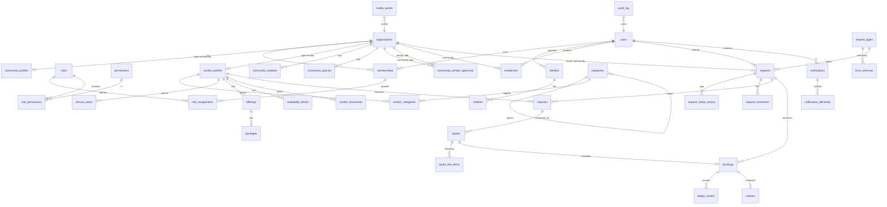

# Database Design (MVP entities and outlines)

PostgreSQL. All tenant-owned tables include `tenant_id`, `created_at`, `updated_at`, `created_by`, `updated_by`; soft delete (`deleted_at`) only where records must be recoverable (users, vendors, offerings, media). Primary keys are UUIDv7 (time-ordered). Foreign keys and check constraints everywhere. Money: `amount_minor bigint`, `currency char(3)`.

## ERD (MVP core)

## As built through the load check (migrations 0001 to 0017)
| Migration | Adds |
|---|---|
| 0001 | users, platform_staff, organizations, memberships, community_profiles, permissions, roles, role_permissions, role_assignments, audit_log, RLS helpers |
| 0002 | permission catalog and system roles |
| 0003 | user_credentials, sessions, platform organization, pre-authentication lookups |
| 0004 | roles visible to their assignee |
| 0005 | one_time_tokens, mfa_credentials, mfa_recovery_codes, `roles.requires_mfa`, column-level grants on users |
| 0006 | community_private, community_facilities, policy_definitions, community_policies, community_status_history, community directory policies, membership detail columns, `communities.assign_admin` |
| 0007 | invite_codes, `app_has_permission`, `app_is_member_role`, `app_invite_valid`, tightened membership and role-assignment policies |
| 0008 | interest_options, families, children, consents (owner-only, no staff access) |
| 0009 | `app_ctx_has_any_permission` (read policies from verified request permissions), `community_internal_notes` (platform-only); least-privilege SELECT policies on users, memberships, role_assignments, audit_log, community_private, community_status_history, invite_codes |
| 0010 | categories (two-level tree, seeded), vetting_requirements (seeded), vendor_profiles, vendor_private, vendor_internal_notes, vendor_status_history, vendor_categories, vendor_service_areas, vendor_documents, vendor_availability_rules, vendor_unavailable_blocks, community_vendor_approvals, offerings; policies that make vendors visible to a community only when active, serving it and approved; `app_is_vendor_staff_role`; membership and role policies extended for vendor teams |
| 0011 | `vendor_vetting_summary` and its trigger (the catalog fails closed on lapsed vetting); `roles.requires_mfa` for vendor owners and administrators |
| 0012 | `workflow_statuses`, `workflow_transitions`, `sla_rules`, `request_types` (seeded reference data); `requests`, `request_status_history`, `request_comments` (tenant = the community); row-level policies for requester, community readers and platform; a workflow trigger enforcing transitions, permissions, notes, the SLA clock and the history |
| 0013 | `request_matches`, `inquiries` (with a privacy snapshot of the request), `quotes`, `quote_line_items`, `bookings`; the `quotes.accept` permission; workflow rows for sourcing, comparing, choosing and booking steps; policies by audience (operations, the addressed vendor, the requesting family); a booking trigger enforcing who may change what and the order of a booking's life |
| 0014 | `request_stage_flags` (trigger-maintained marker that stops vendors quoting once a request has moved on); `booking_payments` (append-only offline payment records) and `bookings.platform_fee_minor`; `reviews` (moderated, one per booking, one vendor reply); booking and review triggers; the quote policy now respects the stage marker |
| 0015 | `saved_offerings` (a resident's private list of offerings, one row per community, person and offering; row-level security shows a person only their own rows in the community they are acting in, with no platform or vendor access; insert and delete only; saving needs `catalog.read` and an offering the caller can see; a trigger caps it at 200) |
| 0017 | Indexes only: `audit_log (created_at DESC, id DESC)` and `requests (created_at DESC, id DESC)`, for the newest-first lists operations reads across every community (found by the load check; 6.9 s to 55 ms and 1.3 s to 60 ms at p95 with 300,000 audit rows and 30,000 requests). No table, policy or grant changed. |
| 0016 | `concerns` (safety and conduct reports: category, optional vendor it is about, subject, details, a status that only moves forward, and the outcome the reporter reads); permissions `concerns.create` (families, community and vendor roles) and `concerns.manage` (operations); row-level security shows a report only to its reporter and to platform staff holding `concerns.manage`, with no vendor or community clause; a trigger fixes what a report says, enforces forward-only status and a required outcome, and records who decided; a trigger caps ten undecided reports per person |

Vendor design decisions: a vendor is an `organizations` row of type `vendor` (reusing status, tenancy, membership and roles); offerings are the sellable units (a "package" is a pricing model, not a separate table, until bookings need it); documents are metadata only (no file storage yet); prices are integer minor units with a currency code; service areas hold either a community or a city plus a travel fee.

Decisions that differ from the original sketch below: families belong to a guardian user (not to a tenant); public and private community data are separate tables; policy definitions are reference data with typed, validated values; member roles are data (`roles`), and which roles membership flows may grant is enforced in the database.

## Table groups (original design sketch)

### Identity and access
`users` (email, phone, password_hash, status, mfa_enabled), `user_profiles`, `sessions`, `mfa_credentials`, `password_resets`, `email_verifications`, `organizations`, `memberships`, `permissions`, `roles`, `role_permissions`, `role_assignments`, `audit_log` (append-only; no update/delete grants).

### Communities
`community_profiles` (location, units, contacts, status), `community_facilities` (venues, capacity, availability rules), `community_policies` (keys such as `vendor_approval_required`, `event_approval_required`), `residencies` (user, community, unit, status, verification method), `invite_codes`.

### Families
`families` (guardian user, privacy settings), `children` (nickname, birth_year or age_band, interests; no photos, no contact data), `consents` (type, version, granted_at, withdrawn_at).

### Vendors and catalog
`vendor_profiles`, `vendor_staff` (membership plus vendor role), `vendor_documents` (type, expiry, verification status, reviewer), `vendor_vetting` (checklist items and outcomes), `categories` (self-referencing tree, `attributes` JSONB), `community_categories` (enablement), `vendor_categories`, `service_areas` (community or locality, travel fee, radius), `offerings` (category, pricing_model, duration, min/max participants, age range, requirements, cancellation policy), `packages`, `availability_blocks` (start, end, kind), `media_assets`, `community_vendor_approvals`.

### Requests, workflow and bookings
`request_types`, `form_schemas`, `workflow_definitions`, `workflow_statuses`, `workflow_transitions`, `sla_rules`, `requests` (answers JSONB, schema_version, workflow_version, status, owner community, requester, budget range, preferred dates), `request_status_history`, `request_comments` (visibility: internal or resident), `request_attachments`, `request_tasks`, `inquiries` (request, vendor, status, sent_at, responded_at), `quotes` (status, validity, total), `quote_line_items`, `shortlists`, `match_runs` and `match_results` (score, reasons JSONB, weights_version, override fields), `bookings` (status, schedule, venue, agreed total), `booking_events`, `reviews` (rating, text, moderation status, vendor reply), `ledger_entries` (see ARCHITECTURE section 8).

### Notifications and configuration
`notification_templates`, `notifications`, `notification_deliveries`, `notification_preferences`, `settings`, `feature_flags`.

## Indexing guidelines
- `(tenant_id, ...)` leading composite indexes on every tenant-owned table to support RLS filtered queries.
- `requests(tenant_id, status, updated_at)`, `inquiries(vendor_id, status)`, `availability_blocks(vendor_id, start, end)` with exclusion constraint (`tstzrange`) to prevent overlapping bookings per vendor.
- GIN indexes on JSONB only where queried; trigram index for catalog search initially (Postgres full text) before adding any search service.
- Partial indexes for soft-delete (`WHERE deleted_at IS NULL`).

## Integrity rules (examples)
- `request_status_history` and `audit_log` and `ledger_entries` are append-only (no UPDATE/DELETE grants; triggers as a backstop).
- Booking cannot be confirmed without an accepted quote unless an ops override reason is recorded.
- Reviews require a completed booking by the same user.
- Vendor document expiry enforced by a scheduled job that moves vendor status to review.

## Migration policy
Forward-only SQL migrations, reviewed; expand-then-contract for destructive change; migrations run with an owner role, application uses a restricted role; each migration includes RLS policy for new tenant tables and the leakage test must pass.

## Deferred (outlined, not designed in detail)
Events, event_vendors, schedules, registrations; rentals, inventory, rental_bookings, returns; products, orders; commercial_rules and settlements; AI tables (conversations, recommendations, usage); analytics marts.
